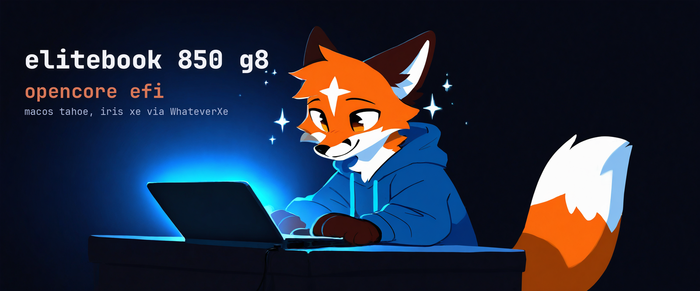

# HP-EliteBook-850-G8-OpenCore-Hackintosh
Welcome to the repository of my hackintosh build. This is the OpenCore EFI for my HP EliteBook 850 G8, running macOS 26 Tahoe (the last macOS that runs on Intel, macOS 27 is Apple Silicon only).

OpenCore 1.0.8 (RELEASE build), SMBIOS MacBookPro16,2. Currently running Tahoe 26.7.2 (25G332) and booting from the laptop's own EFI partition.

# Model used:
HP EliteBook 850 G8 (103c:8846)

# Specs i have
	CPU: Intel Core i5-1145G7 (Tiger Lake, 4 cores 8 threads)
	GPU: Intel Iris Xe Graphics (80 EU, 8086:9A49)
	SSD: 256GB WD SN530 NVMe
	WiFi: Intel AX201
	Bluetooth: Intel 8087:0026
	Audio: Realtek ALC285
	Trackpad: Synaptics SYNA30BE on I2C (with the pointing stick and its 2 buttons)
	Touchscreen: ELAN2513 on I2C

# IMPORTANT:
	This EFI is made for my laptop, it might not work on yours even if it's the same model, its all about luck.
	It only works on Tiger Lake 850 G8s with Iris Xe graphics.
	It uses WhateverXe instead of WhateverGreen. NEVER ADD WHATEVERGREEN, the two must not load together.
	The SMBIOS serials in config.plist are mine. MAKE YOUR OWN with macserial before signing into iCloud.
	MAKE SURE TO BACKUP YOUR DATA AND KEEP A WINDOWS BOOT PATH WORKING.

# What works:
	Graphics Acceleration (Metal, with WhateverXe and the WhateverXe-Graphics pkg)
	Internal Speakers and Headphone Jack (SimpleHDA + custom AppleALC, layout 71)
	Mute key and mute LED
	WiFi (itlwm + HeliPort)
	Bluetooth
	Keyboard and hotkeys
	Trackpad with gestures
	Pointing stick and its buttons (middle button scrolling too)
	Touchscreen
	Battery
	USB-C Charging
	Brightness keys and backlight
	USB ports (USB map included)
	H264 and HEVC hardware video decode
	Booting without the USB

# What doesnt work (so far):
	Sleep/Wake (waking up fails in HP's firmware and the laptop freezes, so sleep is turned off)
	Display sleep (the screen stays black after it turns off, so display sleep is off too)
	Internal Microphone (it's on the Intel DSP, macOS has no driver for it. use a headset, USB or bluetooth mic)
	Thunderbolt hotplug
	Fingerprint, NFC and Smart Card
	FairPlay DRM in Safari (Disney+, Netflix, Apple TV+). use a Chromium based browser or Firefox
	VP9 and AV1 hardware decode
	Boot Chime (the laptop hangs while it starts playing, so it's off)

# What i havent tested yet (Untested)
	HDMI
	External monitors over USB-C (can be flaky on Tiger Lake)
	Webcam

# Keep in note
With "Launch Hotkeys without Fn Keypress" off in the BIOS, the F-keys are normal F1-F12 and you hold fn for the media keys.
- fn + F1 (display switch) is the same as Win + P, so macOS sees it as Cmd + P
- fn + F5 is mute, the orange LED follows it
- fn + F11 (airplane) is F18 and fn + F12 (star) is F17, bind them in System Settings > Keyboard > Keyboard Shortcuts

There's no boot picker, it boots straight into macOS. Hold Esc or Option when you turn it on if you want the picker.

The brightness bar stops a little short of full even when it's at full brightness, that's normal.

Bluetooth LE devices can be flaky, because IntelBTPatcher hangs the boot on 26.7.2 so it's turned off.

Sometimes the GPU hangs after 15 to 30 minutes of being idle. That's mediaanalysisd (the Photos background analysis) breaking the video decoder, turn it off with `launchctl disable gui/501/com.apple.mediaanalysisd` (this loses Photos face and scene search).

# BIOS settings (press F10 on the HP logo)
Already fine: Secure Boot off, Fast Boot off, Sure Start BIOS protection off, BitLocker off.

Change these:
1. Advanced > System Options > Configure Storage Controller for VMD: Off. macOS can't see the SSD while VMD is on. DO THE WINDOWS STEP BELOW FIRST or Windows will bluescreen with INACCESSIBLE_BOOT_DEVICE.
2. Security > Trusted Execution Technology (TXT): Off
3. Leave VT-d and virtualization on
4. Video Memory Size: 128 MB (512 MB breaks the boot with "No slide values are usable")
5. If it hangs early in the boot, also try turning off "Full encryption of main memory (DRAM)"
6. Optional: Battery Health Manager: "Maximize my battery duration" to charge to 100% (the default stops around 96%)

# Turning off VMD without breaking Windows
1. In an admin cmd on Windows: `bcdedit /set {current} safeboot minimal`
2. Reboot into the BIOS, turn VMD off and save
3. Windows boots into safe mode and loads the normal NVMe driver
4. In an admin cmd: `bcdedit /deletevalue {current} safeboot`, then reboot normally

# Steps that ive used
1. Click Download source code as zip in this repository.
2. Extract the zip file
3. In Windows Disk Management, shrink C: to free up space for macOS (60GB is comfortable)
4. Format a USB Drive (at least 2GB) as FAT32 with a GPT partition table (Rufus works: GPT, FAT32)
5. Copy the EFI Folder from the zip to the USB Drive
6. Now get the recovery image and put the com.apple.recovery.boot folder on the USB Drive too. Use macrecovery from the OpenCore Utilities: `python3 macrecovery.py -b Mac-CFF7D910A743CAAF -m 00000000000000000 -os latest download`. The OpenCore Guide shows how: https://dortania.github.io/OpenCore-Install-Guide/installer-guide/
7. Set the BIOS settings above, then press F9 on the HP logo and boot into your USB Drive.
8. In OpenCore pick the macOS Recovery entry and hit enter.
9. Once you're in macOS Recovery, go to Disk Utility and click View and click Show All Devices.
10. Format the free space as APFS and name it whatever you want. (in my case Macintosh HD)
11. Close Disk Utility, join your WiFi from the WiFi icon in the menu bar, then click Reinstall macOS and accept the terms. (if WiFi won't connect, use a USB ethernet adapter, or see the offline install below)
12. Choose your partition and wait until it installs. It takes a long time depending on your internet as macOS is very big.
13. The laptop reboots a few times, pick the macOS Installer entry in OpenCore each time.
14. When the installer is done, boot the partition you made earlier. (in my case Macintosh HD)
15. Now proceed with the setup and after that, your pretty much done.
16. If you made it this far. Congratulations you succesfully installed macOS. But theres a few more things we need to do.

# Offline install (no WiFi needed)
I split my USB Drive in two:
- OPENCORE (16GB, FAT32): the EFI and com.apple.recovery.boot folders
- INSTALL (the rest, exFAT): InstallAssistant.pkg (Tahoe 26.7.2, straight from Apple) and `src/install-tahoe.sh`

FAT32 can't hold files over 4GB, so the 18GB installer goes on the exFAT side.
1. Boot the USB and pick the macOS Recovery entry
2. In Disk Utility make an APFS volume called Macintosh HD in the free space, then quit Disk Utility
3. Utilities > Terminal: `sh /Volumes/INSTALL/install-tahoe.sh`
4. It unpacks the installer onto that volume and starts it. The laptop reboots a few times, pick the macOS Installer entry each time

# After installing
1. Install the WhateverXe Graphics pkg (https://github.com/b00t0x/WhateverXe-Graphics/releases, v0.4.0 or newer) and restart. This is what turns on graphics acceleration.
2. Install HeliPort (https://github.com/OpenIntelWireless/HeliPort/releases) for WiFi. Its own "launch at login" doesn't work on Tahoe, so use a LaunchAgent that runs `open -g -a /Applications/HeliPort.app` at login.
3. Install the SimpleHDA HAL pkg (SimpleHDA-HAL-1.0.1.pkg from the SimpleHDA 1.0.1 release) and reboot. It gives macOS the volume and mute controls.
4. For the mute LEDs: build `src/muteled/muteled.c` (the build line is at the top of the file), copy it to `~/.local/bin/muteled` and copy `src/muteled/dev.neptunethefox.muteled.plist` to `~/Library/LaunchAgents/`.
5. Turn sleep off so the laptop doesn't freeze: `sudo pmset -a hibernatemode 0 standby 0 powernap 0 proximitywake 0 tcpkeepalive 0 displaysleep 0` and `sudo pmset -a disablesleep 1` (closing the lid only turns the screen off).
6. Make your own serial with `macserial -m MacBookPro16,2` and check it isn't a real Mac at https://checkcoverage.apple.com before signing into iCloud.

# Boot into macOS without USB
Now you installed macOS, but you cant boot to it without your USB as you dont have the bootloader on your internal drive yet.
1. In macOS, plug in your USB Drive and run `sudo bash src/install-efi-internal.sh`. It copies the EFI to the laptop's EFI partition and backs up the old one to `~/efi-internal-backup-<time>.tar`.
2. Reboot, press F10 and go to Advanced > Boot Options. Turn on Customized Boot with `\EFI\BOOT\BOOTx64.efi`, HP doesn't boot it on its own.
3. Now Reboot, and now you have the bootloader without the USB Drive. Keep the USB as a rescue stick.
4. Done. You successfully installed macOS and the OpenCore bootloader.

To update single files later without the USB, put them under `~/efi-update/EFI/...` at their real path (and list files to remove in `~/efi-update/delete.txt`), then run `sudo bash src/update-efi-internal.sh`. Each replaced file is kept as `<name>.old-internal`. `sudo bash src/check-efi-internal.sh` shows what's really on the partition.

# Technical stuff
For anyone who wants to know how it's put together. `src/make_efi.py` builds the whole EFI folder and config.plist, so change things there and not only in the output. HANDOFF.md has the full notes on every fix.

Kexts:
- Lilu, VirtualSMC, SMCBatteryManager, SMCProcessor, ECEnabler
- WhateverXe 0.7.0 (the 91270 fork build with the 6 L3 bank fix, upstream rejects the i5-1145G7's GPU, upstream issue 24) and AMFIPass 1.4.1 Mod (the b00t0x one, not upstream)
- AppleALC 1.9.8 (custom build) and SimpleHDA 1.0.1 (Tahoe has no AppleHDA.kext, SimpleHDA brings it back)
- VoodooPS2Controller, VoodooI2C 2.9.1 + VoodooI2CHID (custom build), BrightnessKeys
- itlwm, BlueToolFixup, IntelBluetoothFirmware, IntelBTPatcher (disabled)
- NVMeFix, RestrictEvents, USBToolBox + UTBMap

Custom builds (built on the Mac with only the Xcode command line tools):
- `src/voodooi2c/build.sh`: VoodooI2C 2.9.1 with Tiger Lake I2C controller IDs, `pointing-stick.patch` (the pointing stick is mouse report 0x18 on the Synaptics touchpad, not PS/2), `touchscreen-jumps.patch` (the ELAN panel sends one far off position right before a lift) and VoodooGPIO from master 44fc744 for Tiger Lake GPIO interrupts
- `src/applealc/build.sh`: AppleALC 1.9.8 with layout 71's pin 0x17 path removed. Pin 0x17 isn't wired on this laptop and showed up as a dead second speaker

SSDTs (source in src/):
- SSDT-EC-USBX: fake EC plus USB power properties
- SSDT-AWAC: legacy RTC instead of AWAC
- SSDT-PNLF: backlight
- SSDT-PMC: NVRAM for the 500 series PCH
- SSDT-XOSI: makes the firmware think it's Windows so the I2C devices get their GPIO interrupts
- SSDT-ACFIX: fixes USB-C charging, HP only refreshed the charger state on the barrel charger event
- SSDT-PS2K: keyboard settings, maps fn + airplane to F18

Settings:
- Kernel quirks: LapicKernelPanic (HP needs it), AppleXcpmCfgLock, AppleXcpmExtraMsrs, DisableIoMapper, DisableLinkeditJettison (for SimpleHDA), DisableRtcChecksum, ProvideCurrentCpuInfo
- boot-args: `keepsyms=1 debug=0x100 -allow3d -disablegfxfirmware -lilubetaall revpatch=sbvmm`
- csr-active-config 03080000 and SecureBootModel Disabled, WhateverXe needs both
- Audio: layout-id 71, device-id 34C8 and alc-verbs on PciRoot(0x0)/Pci(0x1F,0x3)
- Boot chime off: the ALC285 only takes 48 kHz, and with a 48 kHz chime the laptop hangs inside AudioDxe (black screen, no Apple logo). The 48 kHz wav stays in Resources/Audio for later

Still to do: Thunderbolt, sleep/wake and display wake.
